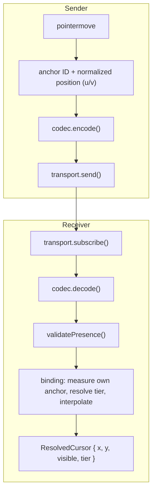

# Anchor Presence

Semantic live cursors for the DOM: different layouts, same meaning.

Each cursor tracks a named element, not a screen pixel. Every client resolves it against its own layout.

Anchor Presence works with Next.js, TanStack Start and Router, Remix and React Router, Vite, and Astro. See [Frameworks](https://anchor-presence.vercel.app/docs/get-started/frameworks).

These terms appear in this README:

- An **anchor** is an element with a `data-anchor` attribute. The attribute value is the anchor ID.
- A **position** is a point inside an anchor, as a fraction from 0 to 1 of its width and of its height.
- The **receiver layout** is the layout of the browser that shows a remote cursor.
- The **fallback chain** is the anchor, its parent anchors, and a viewport position, in this order. The receiver uses the first entry that it can find.
- A **relay** is a server that forwards each message to every other client in a room.

[](LICENSE) [](https://skills.sh)

## Quick start

Install the three packages:

```sh
bun add @dammers/anchor-presence-react @dammers/anchor-presence-dom @dammers/anchor-presence-core
```

Pass the provider a `factory` that creates the transport and the client. Mark one element with `data-anchor`. Then render the provider and the cursor layer:

```tsx
import { createPresenceClient } from "@dammers/anchor-presence-core";
import { createBroadcastChannelTransport } from "@dammers/anchor-presence-dom";
import { CursorLayer, PresenceProvider } from "@dammers/anchor-presence-react";

function createClient() {
  const transport = createBroadcastChannelTransport("live-cursors");
  return createPresenceClient({ transport, user: { name: `Guest ${Math.floor(Math.random() * 100)}` } });
}

export default function App() {
  return (
    <PresenceProvider factory={createClient}>
      <button data-anchor="nav.dashboard">Dashboard</button>
      <CursorLayer />
    </PresenceProvider>
  );
}
```

Open your app in two windows of the same browser, side by side. To get the second window, drag a tab out of the window. Move the pointer in one window. A cursor with a guest name appears in the other window, on the same element, even at a different window size. `createBroadcastChannelTransport` connects the windows and tabs of one origin and needs no server.

When its window loses focus or the pointer leaves the page, the sender clears its cursor. For this reason, two tabs in one window never show each other a cursor.

To connect two browsers, run a relay. Start the Bun relay with `cd examples/bun-native && bun run dev:relay`. Then change the transport in `createClient`:

```ts
const transport = createWebSocketTransport({ port: 8788, path: "/?room=main" });
```

`createWebSocketTransport` comes from `@dammers/anchor-presence-dom`. See the [quick start](https://anchor-presence.vercel.app/docs/get-started/quick-start) for the full steps.

## Requirements

| Requirement | Version                                                                                                              |
| ----------- | -------------------------------------------------------------------------------------------------------------------- |
| React       | 18 or later                                                                                                          |
| TypeScript  | 5.9 or later                                                                                                         |
| Browser     | Chrome, Edge, Firefox, and Safari with ES2022 support                                                                |
| Bun         | Needed to run the demo and the Bun relays. The `ws` relay in `examples/node-ws` also runs on Node.js 22.18 or later. |

## Packages

| Package                          | Description                                                                                                  | Link                                         |
| -------------------------------- | ------------------------------------------------------------------------------------------------------------ | -------------------------------------------- |
| `@dammers/anchor-presence-core`  | Protocol, validation, presence store, and the client. Zero dependencies, no DOM needed.                      | [`packages/core`](packages/core/README.md)   |
| `@dammers/anchor-presence-dom`   | Anchor registry, pointer capture, layout measurement, resolver, WebSocket and `BroadcastChannel` transports. | [`packages/dom`](packages/dom/README.md)     |
| `@dammers/anchor-presence-react` | Provider component and hooks, built on `useSyncExternalStore`.                                               | [`packages/react`](packages/react/README.md) |
| `apps/demo`                      | React admin dashboard that shows correct cursors across layouts.                                             | [`apps/demo`](apps/demo/README.md)           |
| `apps/server`                    | Bun WebSocket relay for the demo.                                                                            | [`apps/server`](apps/server)                 |

## Features

- **Layout-independent positioning.** Cursors track a semantic anchor, not a pixel.
- **Receiver-authoritative.** Each client measures its own DOM.
- **No network on reposition.** A scroll or resize moves a stationary remote cursor for free.
- **Transport-agnostic.** `@dammers/anchor-presence-core` imports no transport library.
- **Framework-optional.** `@dammers/anchor-presence-core` and `@dammers/anchor-presence-dom` run without React. `@dammers/anchor-presence-react` is a thin adapter.
- **Checked input.** Every inbound message passes size and shape limits first.

## Docs

Full documentation, guides, the API reference, and live examples: **[anchor-presence.vercel.app](https://anchor-presence.vercel.app/docs)**.

See also [SPECIFICATION.md](SPECIFICATION.md) for the full technical specification.

## Transport examples

| Example                                                | What it shows                                          |
| ------------------------------------------------------ | ------------------------------------------------------ |
| [`apps/demo`](apps/demo/README.md)                     | The full React demo. Pick the backend with `?backend=` |
| [`apps/server`](apps/server)                           | The reference Bun WebSocket relay, default backend     |
| [`examples/bun-native`](examples/bun-native/README.md) | A `Bun.serve` relay that uses topic pub-sub            |
| [`examples/node-ws`](examples/node-ws/README.md)       | A relay on the `ws` package over `node:http`           |
| [`examples/hono`](examples/hono/README.md)             | A relay on Hono's `upgradeWebSocket` helper            |
| [`examples/elysia`](examples/elysia/README.md)         | A relay on Elysia's `.ws()` route                      |
| [`examples/socketio`](examples/socketio/README.md)     | A Socket.IO transport                                  |
| [`examples/signalr`](examples/signalr/README.md)       | An ASP.NET Core SignalR transport                      |

## Run the demo

The demo needs [Bun](https://bun.sh). Install the dependencies and build the packages:

```sh
bun install
bun run build
```

Run the relay and the demo in two separate terminals:

```sh
# terminal 1: relay
cd apps/server
bun run dev

# terminal 2: demo
cd apps/demo
bun run dev
```

Open the demo URL in two browser windows. Give each window a distinct name, so that you can tell the cursors apart:

```text
http://localhost:5173/?name=Alice&room=main
http://localhost:5173/?room=main
```

Move the pointer in one window. The other window shows a live cursor at the same semantic location, even at a different window size or sidebar state.

## How a cursor travels

This diagram shows the path of one pointer move from the sender to the receiver:



The sender never measures the DOM of the receiver. It sends a semantic anchor ID and a normalized position inside it. The receiver measures its own anchor and turns that into pixels. See [How it works](https://anchor-presence.vercel.app/docs/get-started/concepts/how-it-works) for the full flow and the 10 invariants.

## Capabilities

Anchor Presence has these capabilities:

- Semantic anchors.
- `[data-anchor]` anchors with always-on auto-registration and a configurable `anchorAttribute`.
- Fallback chains and a viewport fallback.
- UI context visibility policies, for example route-aware or dialog-aware rules that your app defines.
- Occlusion detection: a clipped-ancestor check and an optional hit test.
- Interpolation: `noneInterpolator`, `linearInterpolator`, or your own `Interpolator`.
- Any transport: WebSocket, Socket.IO, SignalR, `BroadcastChannel`, or your own.
- Delta encoding for `context` and `user`, and an optional adaptive publish rate.
- SSR-safe hooks.
- Touch input. A touch pointer publishes a cursor with the pointer type `touch`, and the cursor clears when the last touch lifts.

## Pick by intent

**Resolution tier.** What the receiver shows for a resolved cursor:

| Tier       | Use it when                                                                                                         |
| ---------- | ------------------------------------------------------------------------------------------------------------------- |
| `anchor`   | The exact element, or a registered parent, exists on the receiver. Use this as the default. Most cursors land here. |
| `viewport` | No anchor in the fallback chain resolved. Use it to keep a cursor visible on a page with no matching anchors.       |
| `hidden`   | No anchor and no viewport fallback resolved. A policy `"hide"` keeps the tier and sets `visible` to `false`.        |

**Visibility policy outcome.** What to return from a custom `VisibilityPolicy`:

| Outcome                                   | Use it when                                                                             |
| ----------------------------------------- | --------------------------------------------------------------------------------------- |
| `"show"` (default at `anchor`/`viewport`) | Geometric resolution alone decides correctly. Use this for most UI.                     |
| `"hide"` on context mismatch              | The `context.dialog` value of the sender names a dialog that is closed on the receiver. |
| `"hide"` on `!pointVisible`               | A clipping ancestor hides the resolved point.                                           |

## Agent skill

AI coding agents can install the skills for this library. The command installs both skills, `anchor-presence` (integration) and `anchor-presence-audit` (layout audit):

```bash
npx skills add DammersCode/anchor-presence
```

To install only the layout audit skill, add the `--skill` option:

```bash
npx skills add DammersCode/anchor-presence --skill anchor-presence-audit
```

The integration skill teaches an agent the anchor model, the integration steps, and the troubleshooting paths. The source is in [`skills/anchor-presence/`](skills/anchor-presence/).

A second skill, [`skills/anchor-presence-audit/`](skills/anchor-presence-audit/), scores a running app for cursor jumps between layouts and proposes fixes. See [Skills](https://anchor-presence.vercel.app/docs/skills).

## Development commands

Run these commands from the root of the repository:

```sh
bun install                  # install workspace dependencies
bun run build                # build every package (tsc --build)
bun run typecheck            # typecheck the packages, tests, demo, docs, and examples
bun run lint                 # oxlint, type-aware
bun run test                 # unit tests (vitest)
bun run test:browser         # cross-layout browser tests (playwright)
```

Unit tests run through Vitest. Cross-layout tests run through Playwright against Chromium, Firefox, and WebKit.

## Contributing

Read [How it works](https://anchor-presence.vercel.app/docs/get-started/concepts/how-it-works) first for the package boundary rules. Then read [SPECIFICATION.md](SPECIFICATION.md) for the full protocol. Open an issue or a pull request at [github.com/DammersCode/anchor-presence](https://github.com/DammersCode/anchor-presence).

MIT © DammersCode. See [LICENSE](LICENSE).
