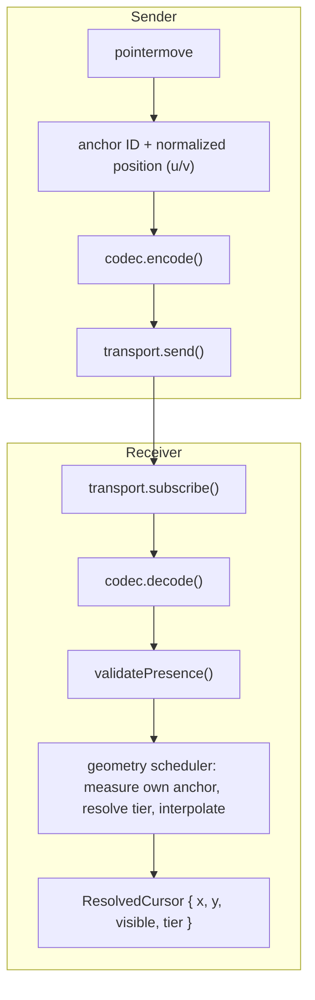

# Anchor Presence

Semantic live cursors for the DOM: different layouts, same meaning.

Each cursor tracks a named element, not a screen pixel. Every client resolves it against its own layout.

[](LICENSE) [](https://skills.sh)

## Quick start

Install the three packages.

```sh
bun add @anchor-presence/react @anchor-presence/dom @anchor-presence/core
```

Create a client with a transport. Mark one element with `data-anchor`. Then render the provider and the cursor layer.

```tsx
import { createPresenceClient } from "@anchor-presence/core";
import { createWebSocketTransport } from "@anchor-presence/dom";
import { LiveCursorProvider, CursorLayer } from "@anchor-presence/react";

const transport = createWebSocketTransport({ url: "ws://localhost:8787/?room=main" });
transport.connect();
const client = createPresenceClient({ transport, user: { name: "Alice" } });

function DashboardButton() {
  return <button data-anchor="nav.dashboard">Dashboard</button>;
}

function App() {
  return (
    <LiveCursorProvider client={client}>
      <DashboardButton />
      <CursorLayer />
    </LiveCursorProvider>
  );
}
```

`apps/server` is the matching relay for this example: run `cd apps/server && bun run dev` to start it. `room` is a relay-side grouping key, not part of the protocol.

Any bidirectional byte channel that implements the transport interface works in place of `createWebSocketTransport`. See [docs/transports.md](docs/transports.md) for the WebSocket usage and the Socket.IO, SignalR, and BroadcastChannel examples.

Open your app in two browser windows. Move the pointer in one window. A live cursor appears in the second window, tracking the same element even at a different window size.

## Requirements

| Requirement | Version |
|---|---|
| React | 18 or later |
| TypeScript | 5.9 or later |
| Browser | Current versions of Chrome, Edge, Firefox, and Safari |
| Bun | Needed to run the demo and the relay |

## Packages

| Package | Description | Link |
|---|---|---|
| `@anchor-presence/core` | Protocol, validation, presence store, client orchestration. Zero dependencies, no DOM globals. | [`packages/core`](packages/core/README.md) |
| `@anchor-presence/dom` | Anchor registry, pointer capture, geometry scheduler, resolver. | [`packages/dom`](packages/dom/README.md) |
| `@anchor-presence/react` | Provider component and hooks, built on `useSyncExternalStore`. | [`packages/react`](packages/react/README.md) |
| `apps/demo` | React admin dashboard demonstrating cross-layout cursor correctness. | [`apps/demo`](apps/demo/README.md) |
| `apps/server` | Bun WebSocket relay for the demo. | [`apps/server`](apps/server) |

## Features

- **Layout-independent positioning.** Cursors track a semantic anchor, not a pixel.
- **Receiver-authoritative.** Each client measures its own DOM.
- **No network on reposition.** A scroll or resize moves a stationary remote cursor for free.
- **Transport-agnostic.** Core imports no transport library.
- **Framework-optional.** `core` and `dom` run without React. The React package is a thin adapter.
- **Validated input.** Every inbound message passes size and shape limits first.

## Docs

| File | What it covers |
|---|---|
| [`docs/architecture.md`](docs/architecture.md) | Package layers, sender-to-receiver flow, the 10 invariants |
| [`docs/concepts.md`](docs/concepts.md) | Anchors, anchor IDs, normalized coordinates, fallback chains, resolution tiers |
| [`docs/responsive-layouts.md`](docs/responsive-layouts.md) | How layout differences resolve, with a worked example |
| [`docs/ui-context.md`](docs/ui-context.md) | Opaque context, visibility policies, dialog mismatch handling |
| [`docs/react.md`](docs/react.md) | Provider and hook reference, custom interpolation, examples |
| [`docs/transports.md`](docs/transports.md) | The transport interface, plus WebSocket, Socket.IO, SignalR, and BroadcastChannel examples |
| [`docs/codecs.md`](docs/codecs.md) | The codec interface, `jsonCodec`, `binaryCodec`, a MessagePack sketch, and the validation boundary |
| [`docs/performance.md`](docs/performance.md) | The geometry scheduler model and performance guidance |
| [`docs/security.md`](docs/security.md) | Validation limits, anchor ID safety, rendering rules |
| [`docs/troubleshooting.md`](docs/troubleshooting.md) | Common problems and their causes |

See also [SPECIFICATION.md](SPECIFICATION.md) for the full technical specification.

## Transport examples

| Example | What it shows |
|---|---|
| [`apps/demo`](apps/demo/README.md) | The full React demo with a plain WebSocket relay |
| [`apps/server`](apps/server) | The Bun WebSocket relay used by the demo |
| [`examples/socketio`](examples/socketio/README.md) | A Socket.IO transport |
| [`examples/signalr`](examples/signalr/README.md) | An ASP.NET Core SignalR transport |

## Run the demo

Requires [Bun](https://bun.sh).

```sh
bun install
bun run build
```

Run the relay and the demo in two separate terminals.

```sh
# terminal 1: relay
cd apps/server
bun run dev

# terminal 2: demo
cd apps/demo
bun run dev
```

Open the demo URL in two browser windows. Give each window a distinct name so the cursors are easy to tell apart.

```text
http://localhost:5173/?name=Alice&room=main
http://localhost:5173/?room=main
```

Move the pointer in one window. The other window shows a live cursor tracking the same semantic location, even at a different window size or sidebar state.

## The Contract



The sender never measures the DOM of the receiver. It sends a semantic anchor ID and a normalized position inside it. The receiver measures its own anchor and turns that into pixels. See [docs/architecture.md](docs/architecture.md) for the full flow and the 10 invariants.

## Capability matrix

| Capability | React |
|---|---|
| Semantic anchors | ✅ |
| `[data-anchor]` anchors with always-on auto-registration and configurable `anchorAttribute` | ✅ |
| Fallback chains | ✅ |
| Viewport fallback | ✅ |
| UI context visibility policies (route- or dialog-aware, application-defined) | ✅ |
| Occlusion detection (clipped-ancestor + optional hit-test) | ✅ |
| Interpolation (`none`, `linear`, or a custom `Interpolator`) | ✅ |
| Transport-agnostic (bring your own WebSocket, Socket.IO, SignalR, `BroadcastChannel`) | ✅ |
| Delta `context`/`user` wire encoding + optional adaptive publish rate | ✅ |
| SSR-safe hooks | ✅ |
| Mobile viewing (read-only presence) | ✅ |
| Mobile sending (touch as a pointer source) | not supported |

## Pick by intent

**Resolution tier.** What the receiver shows for a resolved cursor:

| Tier | Use it when |
|---|---|
| `anchor` | The exact element, or a registered parent, exists on the receiver. Use this as the default. Most cursors land here. |
| `viewport` | No anchor in the fallback chain resolved. Use it to keep a cursor visible on a page with no matching anchors. |
| `hidden` | Nothing resolved, or a visibility policy chose to hide the cursor. |

**Visibility policy outcome.** What to return from a custom `VisibilityPolicy`:

| Outcome | Use it when |
|---|---|
| `"show"` (default at `anchor`/`viewport`) | Geometric resolution alone decides correctly. Use this for most UI. |
| `"hide"` on context mismatch | The `context.dialog` value of the sender names a dialog that the receiver has not opened. |
| `"hide"` on `!pointVisible` | A clipping ancestor hides the resolved point. |

## Agent skill

AI coding agents can install the integration skill for this library:

```bash
npx skills add DammersCode/anchor-presence
```

The skill teaches an agent the anchor model, the integration steps, and the troubleshooting paths. The source is in [`skills/anchor-presence/`](skills/anchor-presence/).

## Development commands

```sh
bun install                  # install workspace dependencies
bun run build                # build every package (tsc --build)
bun run typecheck             # build-mode typecheck for core, dom, react
bun run lint                  # oxlint, type-aware
bun run test                  # unit tests (vitest)
bun run test:browser          # cross-layout browser tests (playwright)
```

Unit tests run through Vitest. Cross-layout tests run through Playwright against Chromium, Firefox, and WebKit.

## Contributing

Read [docs/architecture.md](docs/architecture.md) first for the package boundary rules. Then read [SPECIFICATION.md](SPECIFICATION.md) for the full protocol. Open an issue or a pull request at [github.com/DammersCode/anchor-presence](https://github.com/DammersCode/anchor-presence).

MIT © DammersCode. See [LICENSE](LICENSE).
