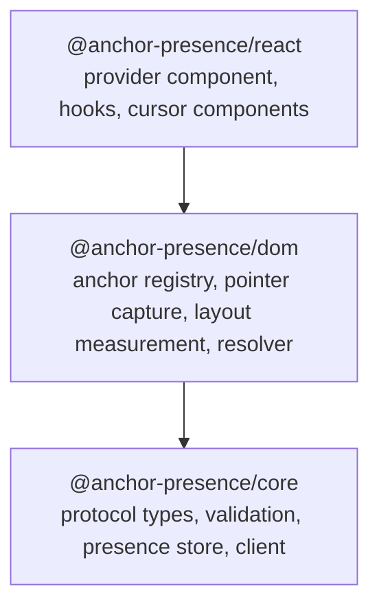
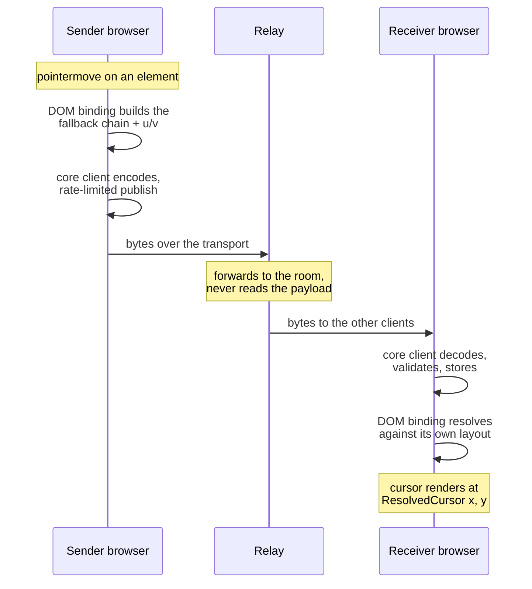

import { Anchor, Gauge, Scaling, Waypoints } from "lucide-react";

Anchor Presence turns a pointer move into an element ID and a point inside that element. Each receiver places the cursor against its own layout. Read this page to know which package does what, and which rules the library never breaks. The [Introduction](/docs/get-started/introduction#the-fix) defines the terms anchor, position, receiver, fallback chain, peer, and relay.

The central rule of the library is:

> A remote cursor represents a semantic DOM location, not an absolute screen coordinate.

## Package layers

Each package adds one layer, and the dependency direction is one-way:

- `@anchor-presence/core` has no dependencies and needs no DOM. It runs in Node.js, Bun, workers, and browsers. It owns the protocol, validation, message order, the store of remote presence, and the client. If a `document` exists, the client listens for `visibilitychange` to send a pending update when the page shows again.
- `@anchor-presence/dom` depends only on `@anchor-presence/core`. It owns every layout and pointer API call: the anchor registry, pointer capture, layout measurement once per animation frame, and visibility policies. The core client only listens to `visibilitychange`, to send a pending update when the tab turns visible.
- `@anchor-presence/react` is an adapter only. It keeps no cursor state of its own. It reads the stores of the other two packages with `useSyncExternalStore`.

## Path of one pointer move

A pointer move never reaches the receiver as a raw pixel. The sender sends an anchor ID and a position, and the receiver measures its own anchors:

The receiver keeps the latest presence of each peer. [Remote presence](/docs/core/remote-presence) explains the two read methods of the client and when to use each.

## The 10 invariants

An invariant is a rule that holds for every message. Other pages refer to these numbers:

1. The sender never uses its screen coordinates as the main position. The main position is an anchor and a point inside it.
2. The layout of the receiver decides where a cursor appears.
3. A semantic anchor keeps its ID when a responsive layout changes.
4. A missing anchor degrades in a fixed order: the exact anchor, then each ancestor anchor, then the viewport position. Then the visibility policy decides.
5. Framework adapters do not own presence state. `@anchor-presence/core` owns it.
6. The cursor logic does not depend on a transport. `@anchor-presence/core` imports no transport library.
7. A local layout change moves a stationary remote cursor without a new network message.
8. A network message cannot run a DOM selector. Anchor IDs resolve only against the registered anchor map.
9. The consumer controls rendering. No cursor component is required. `@anchor-presence/react` has optional cursor components.
10. All cursor state lives in `@anchor-presence/core` and `@anchor-presence/dom`. An adapter for another framework, such as Svelte, Vue, or Solid, uses both packages without a change.

## Why the receiver layout decides

The receiver resolves each cursor against its own DOM. As a result, local scrolling and resizing cause no network traffic. The binding measures the same anchor again and moves the cursor (invariant 7).

## Related

<Cards>
  <Card icon={<Anchor />} title="Anchors" href="/docs/get-started/concepts/anchors">
    Anchor IDs and the u/v position.
  </Card>
  <Card icon={<Waypoints />} title="Fallback chain" href="/docs/get-started/concepts/fallback-chain">
    The order of the fallback steps.
  </Card>
  <Card icon={<Scaling />} title="Responsive layouts" href="/docs/get-started/concepts/responsive-layouts">
    A worked example across two layouts.
  </Card>
  <Card icon={<Gauge />} title="Performance" href="/docs/get-started/guides/performance">
    What the layout measurement costs.
  </Card>
</Cards>
