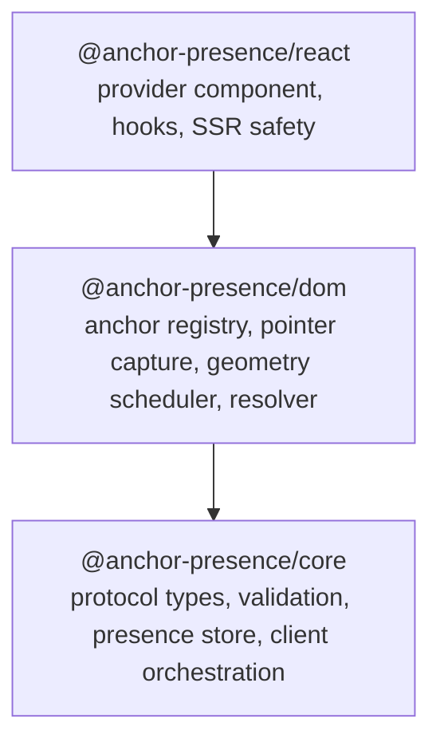
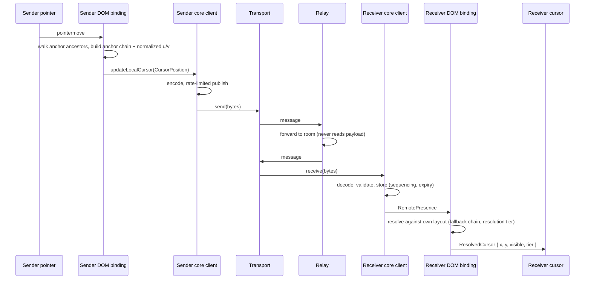

Anchor Presence shows remote user cursors at the correct semantic position. It does not use a canvas. It works even when two clients have different layouts.

The central invariant:

> A remote cursor represents a semantic DOM location, not an absolute screen coordinate.

## Package layers

The system has three packages. Each package adds one layer, and the dependency direction is one-way: `@anchor-presence/react` depends on `@anchor-presence/dom`, and `@anchor-presence/dom` depends on `@anchor-presence/core`.

- `@anchor-presence/core` has zero dependencies and no DOM globals. It runs in Node.js, Bun, workers, and browsers. It owns the protocol, validation, sequencing, the remote presence store, and client orchestration.
- `@anchor-presence/dom` depends only on `@anchor-presence/core`. It owns every browser API call, the anchor registry, pointer capture, the geometry scheduler, and visibility policies.
- `@anchor-presence/react` is an adapter only. It holds no engine state. It subscribes to `@anchor-presence/core` and `@anchor-presence/dom` stores with `useSyncExternalStore`, and declares anchors through the binding's anchor attribute, with no separate registration helper of its own.

## Sender to receiver flow

A local pointer move never reaches the receiver as a raw pixel: the sender encodes a semantic position, and the receiver resolves it against its own layout.

The sender never measures the receiver's DOM. The sender sends a semantic anchor ID and a normalized position inside it. The receiver measures its own anchors and turns that data into pixels.

## Reading the remote state

The receiver's client stores every accepted remote presence. It exposes two read APIs.

`getRemoteSnapshot()` returns the raw store, including each presence's `sequence`. Its identity changes on every accepted message. Use it for tests and diagnostics.

`getRemotePresence()` returns a render-stable projection. Each entry is a `RemotePresence` without `sequence`. Its identity changes only when an observable field changes. The React adapter reads this projection, so a remote cursor move re-renders only the consumers that need it.

## The 10 invariants

1. Absolute sender screen coordinates are never the primary cross-client positioning representation.
2. Receiver layout is authoritative.
3. Semantic anchors survive responsive layout changes.
4. Missing exact anchors degrade predictably: exact anchor, then nearest registered parent, then larger region, then viewport fallback, then visibility policy.
5. Framework adapters do not own core presence state.
6. Transport implementation is independent from cursor logic. `@anchor-presence/core` imports no transport library.
7. A local layout change repositions a stationary remote cursor without a new network packet.
8. Network messages cannot execute arbitrary DOM selectors. Anchor IDs resolve only against the registered anchor map.
9. Rendering is consumer-controlled. No cursor component is required. `@anchor-presence/react` provides optional, configurable cursor components.
10. Future framework adapters, such as Svelte, Vue, or Solid, require no architectural rewrite.

## Why receiver layout is authoritative

Resolving against the receiver's own DOM also makes local scrolling and resizing free: the geometry scheduler re-measures the same anchor and moves the cursor with no new network message (Invariant 7). See [Anchors](/docs/get-started/concepts/anchors) for the coordinate math, and [Responsive layouts](/docs/get-started/concepts/responsive-layouts) for a worked example across two different layouts.

## Related

- [Anchors](/docs/get-started/concepts/anchors)
- [Fallback chain](/docs/get-started/concepts/fallback-chain)
- [Responsive layouts](/docs/get-started/concepts/responsive-layouts)
- [Performance](/docs/get-started/guides/performance)
