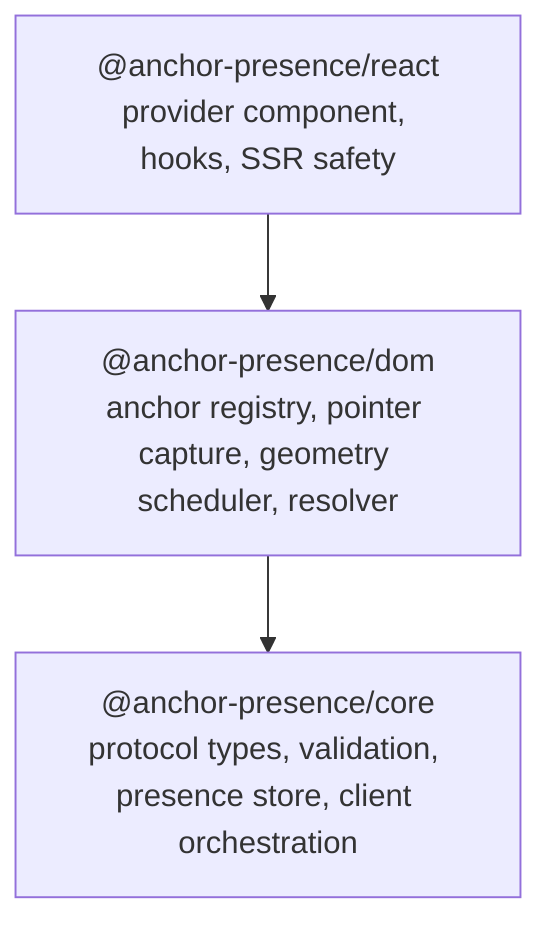
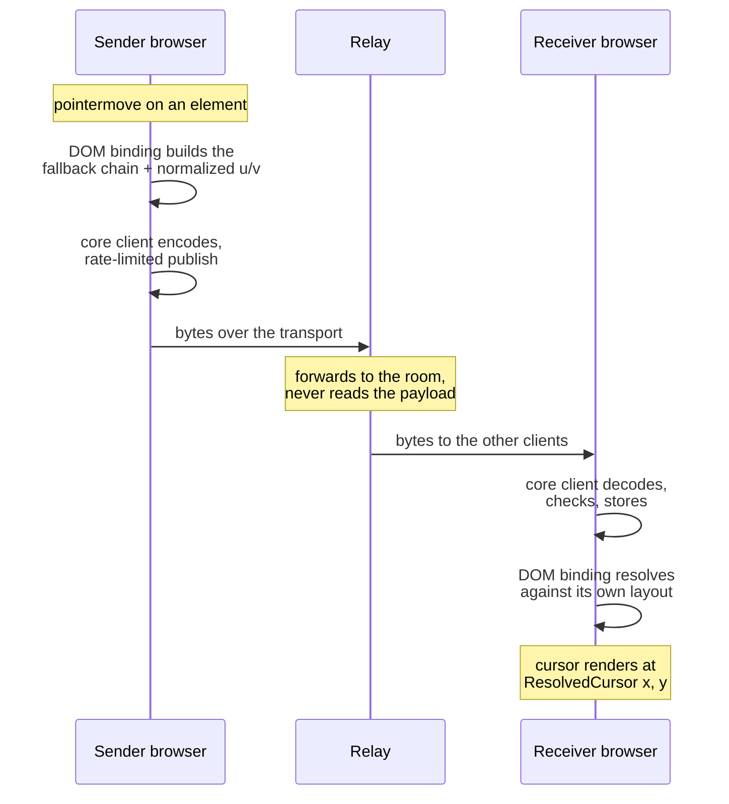

Anchor Presence shows remote cursors at the correct semantic position. It does not use a canvas. It works even when two clients have different layouts.

This central invariant gives the library its design:

> A remote cursor represents a semantic DOM location, not an absolute screen coordinate.

## Package layers

The system has three packages. Each package adds one layer, and the dependency direction is one-way. `@anchor-presence/react` depends on `@anchor-presence/dom`, and `@anchor-presence/dom` depends on `@anchor-presence/core`:

- `@anchor-presence/core` has zero dependencies and needs no DOM. If `document` exists, it reads `document` to send a pending update when the page becomes visible again. It runs in Node.js, Bun, workers, and browsers. It owns the protocol, validation, sequencing, the remote presence store, and client orchestration.
- `@anchor-presence/dom` depends only on `@anchor-presence/core`. It owns every browser API call, the anchor registry, pointer capture, the geometry scheduler, and visibility policies.
- `@anchor-presence/react` is an adapter only. It holds no engine state. It subscribes to `@anchor-presence/core` and `@anchor-presence/dom` stores with `useSyncExternalStore`, and declares anchors through the binding's anchor attribute, with no separate registration helper of its own.

## Sender to receiver flow

A local pointer move never reaches the receiver as a raw pixel. The sender encodes a semantic position, and the receiver resolves it against its own layout. This diagram shows the path of one move:

The sender never measures the receiver's DOM. The sender sends a semantic anchor ID and a normalized position inside it. The receiver measures its own anchors and turns that data into pixels.

## Read the remote state

The receiver's client stores every accepted remote presence. It exposes two read APIs.

`getRemoteSnapshot()` returns the raw snapshot, including each presence's `sequence`. Its identity changes on every accepted message. Use it for tests and diagnostics.

`getRemotePresence()` returns a stable snapshot. Each entry is a `RemotePresence` without `sequence`. Its identity changes only when an observable field changes. The React adapter reads this stable snapshot. A remote cursor move therefore rerenders only the consumers that need it.

## The 10 invariants

The invariants have numbers, so that other pages can refer to them:

1. The sender never uses its screen coordinates as the main position. The main position is an anchor and a point inside it.
2. The layout of the receiver decides where a cursor appears.
3. A semantic anchor keeps its ID when a responsive layout changes.
4. A missing anchor degrades in a fixed order: the exact anchor, then each ancestor anchor, then the viewport position. Then the visibility policy decides.
5. Framework adapters do not own presence state. `@anchor-presence/core` owns it.
6. The cursor logic does not depend on a transport. `@anchor-presence/core` imports no transport library.
7. A local layout change moves a stationary remote cursor without a new network message.
8. A network message cannot run a DOM selector. Anchor IDs resolve only against the registered anchor map.
9. The consumer controls rendering. No cursor component is required. `@anchor-presence/react` has optional cursor components.
10. All engine state lives in `@anchor-presence/core` and `@anchor-presence/dom`. An adapter for another framework, such as Svelte, Vue, or Solid, uses both packages without a change.

## Why receiver layout is authoritative

The receiver resolves each cursor against its own DOM. Local scrolling and resizing therefore cost no network traffic: the geometry scheduler measures the same anchor again and moves the cursor (invariant 7). See [Anchors](/docs/get-started/concepts/anchors) for the coordinate math, and [Responsive layouts](/docs/get-started/concepts/responsive-layouts) for a worked example across two different layouts.

## Related

- [Anchors](/docs/get-started/concepts/anchors)
- [Fallback chain](/docs/get-started/concepts/fallback-chain)
- [Responsive layouts](/docs/get-started/concepts/responsive-layouts)
- [Performance](/docs/get-started/guides/performance)
