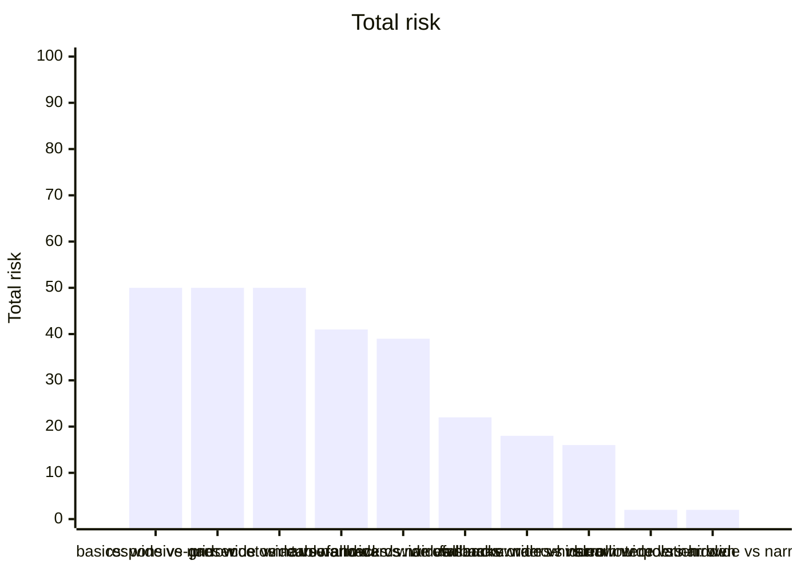
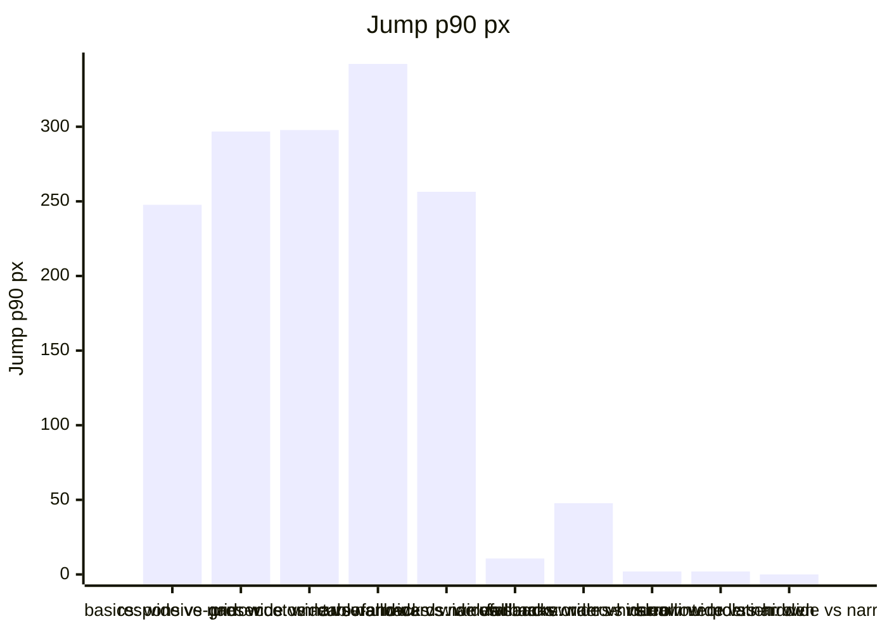
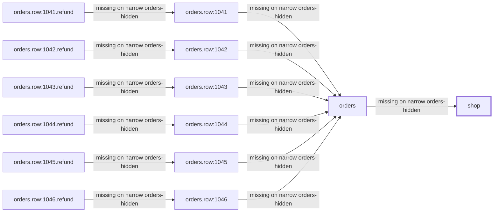
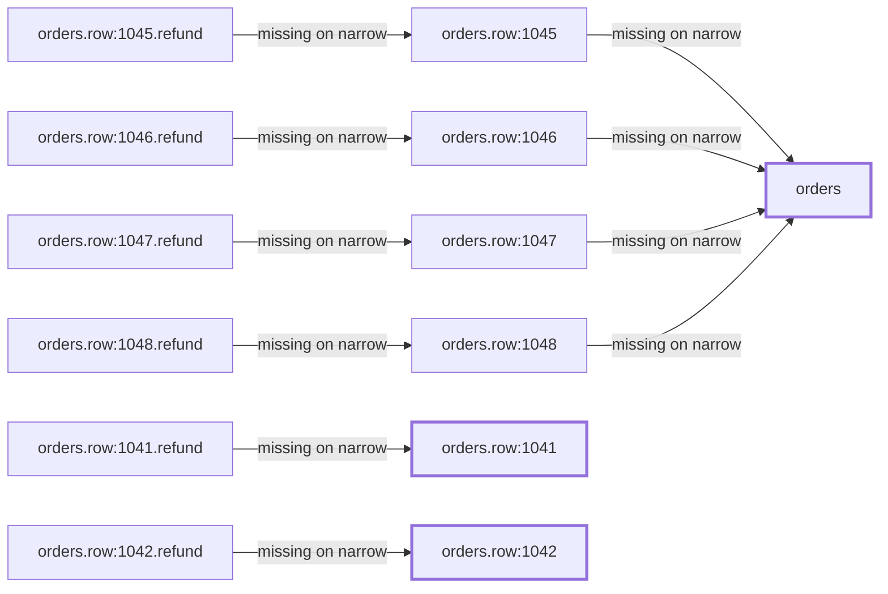
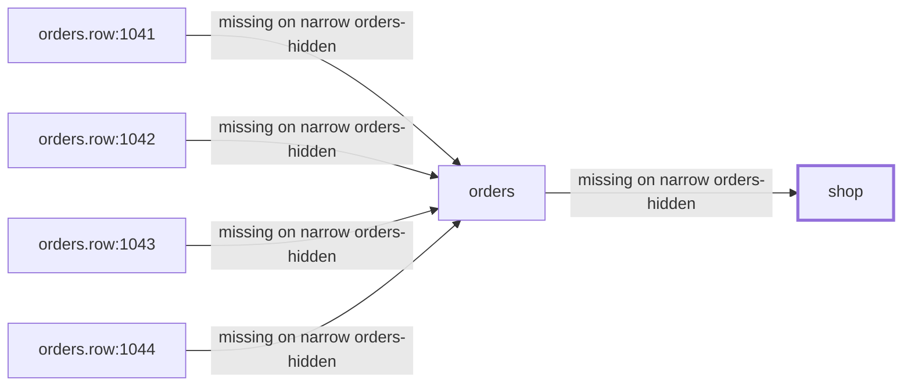

# Research: layout audit dogfood on the docs example scenes

Status: research note. Run on 2026-09-25 against the docs dev server (`http://localhost:3001`) with the `anchor-presence-audit` skill scripts. Spec: [plan 028](../028-layout-audit-skill.md). Metric definitions: `skills/anchor-presence-audit/scoring.md`.

## Setup

- Config: [presence-layout-audit-dogfood.config.json](presence-layout-audit-dogfood.config.json). Each scene has two explicit views, the frame pages `/demo-frame/<scene>/wide` and `/demo-frame/<scene>/narrow`, sized like the preview panes on a 1440 px docs page (477×338 and 317×338). The fallbacks scene has a third view: narrow with the "Show orders" switch turned off (`click: button[role=switch]`).
- Commands, from the repo root:

```sh
node skills/anchor-presence-audit/scripts/measure.mjs --config plans/research/presence-layout-audit-dogfood.config.json --out anchor-audit.json
node skills/anchor-presence-audit/scripts/report.mjs --in anchor-audit.json --format markdown,mermaid --out report.md
```

- 17 views, 10 view pairs, 23 s against the dev server. The generated report follows at the end, unchanged except for the heading levels.
- Every Mermaid block was rendered with Mermaid 12.0.0 in Chromium (`xychart-beta` and `flowchart`) without errors.

## Results against each scene's intent

| Scene           | Total | Band            | Driving sub-scores        | Matches the scene?                                                                                                                                                                      |
| --------------- | ----: | --------------- | ------------------------- | --------------------------------------------------------------------------------------------------------------------------------------------------------------------------------------- |
| basics          |    50 | moderate        | jump 100, aspect 100      | No, against the expectation "small". Verified real in the live library (see below).                                                                                                     |
| responsive-grid |    50 | moderate        | jump 100, aspect 100      | Yes. The reflow moves `metrics.orders` from the right of `metrics.revenue` to below it, and the traffic chart from a 2×2 block to a full-width row. Jumps near 300 px in a 317 px pane. |
| presence        |    50 | moderate        | jump 100, aspect 100      | Yes. The three board columns turn into three rows; a move from one column to the next crosses the narrow pane.                                                                          |
| custom-cursors  |    41 | moderate        | jump 100, aspect 37       | Yes. The hero moves from a left column to a full-width top row, so its neighbors change sides.                                                                                          |
| table-and-cards |    39 | moderate        | jump 100, aspect 24       | Yes. Status to amount is a 0 px move in the table row and a 275 px move in the card (status top right, amount second line left), as the coordinator note in the research predicted.     |
| fallbacks       | 16–22 | low to moderate | depth 50–75, parity 67–94 | Yes. Depth and parity carry the score. Jumps stay small because every missing anchor falls back to a close parent (`orders.row:<id>`, `orders`, `shop`).                                |
| scroll          |     2 | low             | none                      | Yes, after the clipping correction below. The threads keep their order and height.                                                                                                      |
| interpolation   |     2 | low             | none                      | Yes. The four targets are identical 44 px circles in both panes and sit too far apart to count as neighbors.                                                                            |

The shape of the scale: with full anchor coverage and every anchor in both views, a pair tops out at 50 (Jump 35 + Aspect 15). All five reflow scenes sit at or near that ceiling, which is correct for layouts that change neighbors on purpose. Only gaps, deep fallbacks, or missing anchors push a pair into the high band. No scene has an uncovered gap: each one anchors its outer container.

## Where results contradicted expectations

### scroll scored 27 (gap 100): metric fixed

The first run gave the scroll scene a gap sub-score of 100: 42% of the box around the nine threads had no anchored parent in the narrow view. In the scene, the narrow list is a 148 px scroll container, and threads 6 to 9 sit below its clip edge. The sampled box included that clipped area, where `elementFromPoint` hit the hint paragraph under the list. A pointer cannot reach clipped content, so the finding was wrong.

Fix in `measure.mjs` and `score.mjs`: each anchor carries a visible box (its box clipped by every scrolling or clipping ancestor). Gap sampling, adjacency, and depth use the visible box, because they model the sender's pointer. The receiver keeps the full box, because the resolver resolves clipped anchors too. Result: scroll 2 (low).

### Corner neighbors counted as moves: metric fixed

The first run listed `invoices.row:INV-2042.status -> invoices.row:INV-2043.amount` as the worst table-and-cards jump: two cells that touch at one corner only. The binding definition speaks of facing edges, and a real pointer path rarely crosses a single corner point. Adjacency now requires the two boxes to overlap on one axis. The worst table-and-cards jumps are now status to amount in the same row, the case the coordinator note describes.

### basics scored 50, not small: metric confirmed, expectation was wrong

The basics wide pane shows three buttons in a row (`justify-end`, 66–82 px wide). The narrow pane uses `flex-col`, which stretches each button to 251 px. A move from the right edge of Save draft to the left edge of Preview is 8 px on the sender. The resolver maps the leave point to the right end of the stretched Save button, and the enter point to the left end of the stretched Preview button below it: 248 px.

To test the model against the real library, a Playwright script moved the mouse in the wide iframe of `/docs/examples/basics` and read the remote cursor in the narrow iframe:

| Pointer x in the wide pane        | Resolved anchor in the narrow pane | Remote cursor in the narrow pane |
| --------------------------------- | ---------------------------------- | -------------------------------- |
| 258.8 (inside Save, right edge)   | `post.save`                        | (277.9, 163)                     |
| 263.8 (the gap)                   | `post`                             | (176.5, 220.2)                   |
| 268.8 (inside Preview, left edge) | `post.preview`                     | (33, 203)                        |

A 10 px pointer move moved the remote cursor 248 px, the same distance the metric computes. The score is right: the scene shows that the exact button is found in both layouts, and it also shows the reflow jump that the layout guide warns about. The docs guide (`get-started/guides/layout-design`) uses this scene as its example.

A what-if run tested two fixes from `fixes.md` without code changes, through a `setAttribute` step on the narrow button row:

| Narrow button row                           | Total | Changed sub-scores         |
| ------------------------------------------- | ----: | -------------------------- |
| `flex flex-col` (shipped)                   |    50 | jump 100, aspect 100       |
| `flex flex-col items-end` (keep sizes)      |    16 | jump 100→23, aspect 100→56 |
| `flex flex-wrap justify-end` (keep the row) |     2 | jump 100→0, aspect 100→13  |

Both fixes lower the sub-scores that `fixes.md` names for them. The scene stays as it is: its job is to show anchor resolution across a reflow.

## Follow-ups

- The weights and thresholds are the research proposal, not fitted to data. Compare scores with user reports after audits of real apps.
- The five reflow scenes all score at the 50 ceiling. Telling a mild reflow from a severe one inside that ceiling needs a change to the fixed formula; out of scope for plan 028.

---

## Generated report

### Scores

Measured 17 views against http://localhost:3001 on 2026-09-25.
Higher is worse: 0-20 low, 21-50 moderate, 51-100 high.

| View pair                                 | Total | Band     | Jump | Gap | Depth | Aspect | Parity |
| ----------------------------------------- | ----: | -------- | ---: | --: | ----: | -----: | -----: |
| basics: wide vs narrow                    |    50 | moderate |  100 |   0 |     0 |    100 |      0 |
| responsive-grid: wide vs narrow           |    50 | moderate |  100 |   0 |     0 |    100 |      0 |
| presence: wide vs narrow                  |    50 | moderate |  100 |   0 |     0 |    100 |      0 |
| custom-cursors: wide vs narrow            |    41 | moderate |  100 |   0 |     0 |     37 |      0 |
| table-and-cards: wide vs narrow           |    39 | moderate |  100 |   0 |     0 |     24 |      0 |
| fallbacks: wide vs narrow orders-hidden   |    22 | moderate |    0 |   0 |    75 |     12 |     94 |
| fallbacks: wide vs narrow                 |    18 | low      |    4 |   0 |    50 |     15 |     67 |
| fallbacks: narrow vs narrow orders-hidden |    16 | low      |    0 |   0 |    50 |      0 |     83 |
| scroll: wide vs narrow                    |     2 | low      |    0 |   0 |     0 |     14 |      0 |
| interpolation: wide vs narrow             |     2 | low      |    0 |   0 |     0 |     14 |      0 |

### Findings per view pair

#### basics: wide vs narrow — 50 (moderate)

| Input               |                          Value | Sub-score |
| ------------------- | -----------------------------: | --------: |
| Jump p90            | 247.7 px over 4 adjacent moves |       100 |
| Gap uncovered       |                             0% |         0 |
| Depth delta (worst) |                              0 |         0 |
| Aspect amp p90      |     3.8x over 4 shared anchors |       100 |
| Missing in one view |                    0% of 4 IDs |         0 |

Largest jumps (sender move -> receiver move):

- `post.save` -> `post.preview`: 8 px on wide becomes 247.7 px on narrow (`post.save` -> `post.preview`)
- `post.preview` -> `post.publish`: 8 px on wide becomes 247 px on narrow (`post.preview` -> `post.publish`)
- `post.save` -> `post.preview`: 8 px on narrow becomes 90.1 px on wide (`post.save` -> `post.preview`)
- `post.preview` -> `post.publish`: 8 px on narrow becomes 82.5 px on wide (`post.preview` -> `post.publish`)

Largest shape changes:

- `post.publish`: 3.8x (66x32 on wide, 251x32 on narrow) at `div > div:nth-of-type(1) > section > div > button:nth-of-type(3)`
- `post.preview`: 3.5x (72x32 on wide, 251x32 on narrow) at `div > div:nth-of-type(1) > section > div > button:nth-of-type(2)`
- `post.save`: 3.05x (82x32 on wide, 251x32 on narrow) at `div > div:nth-of-type(1) > section > div > button:nth-of-type(1)`
- `post`: 2.25x (384x149 on wide, 285x248 on narrow) at `div:nth-of-type(3) > div > div:nth-of-type(1) > section`

#### responsive-grid: wide vs narrow — 50 (moderate)

| Input               |                           Value | Sub-score |
| ------------------- | ------------------------------: | --------: |
| Jump p90            | 296.8 px over 44 adjacent moves |       100 |
| Gap uncovered       |                              0% |         0 |
| Depth delta (worst) |                               0 |         0 |
| Aspect amp p90      |    3.56x over 16 shared anchors |       100 |
| Missing in one view |                    0% of 16 IDs |         0 |

Largest jumps (sender move -> receiver move):

- `metrics.traffic` -> `metrics.conversion`: 6 px on wide becomes 311.5 px on narrow (`metrics.traffic` -> `metrics.conversion`)
- `metrics.traffic` -> `metrics.active`: 6 px on wide becomes 307.5 px on narrow (`metrics.traffic` -> `metrics.active`)
- `metrics.revenue` -> `metrics.orders`: 6 px on wide becomes 298.7 px on narrow (`metrics.revenue` -> `metrics.orders`)
- `metrics.traffic.sun` -> `metrics.conversion`: 17 px on wide becomes 297.2 px on narrow (`metrics.traffic.sun` -> `metrics.conversion`)
- `metrics.traffic.sun` -> `metrics.active`: 17 px on wide becomes 296.8 px on narrow (`metrics.traffic.sun` -> `metrics.active`)

Largest shape changes:

- `metrics.orders`: 3.56x (110x91 on wide, 146x34 on narrow) at `div:nth-of-type(3) > div > div:nth-of-type(1) > div:nth-of-type(2)`
- `metrics.refunds`: 3.56x (110x91 on wide, 146x34 on narrow) at `div:nth-of-type(3) > div > div:nth-of-type(1) > div:nth-of-type(3)`
- `metrics.conversion`: 3.56x (110x91 on wide, 146x34 on narrow) at `div:nth-of-type(3) > div > div:nth-of-type(1) > div:nth-of-type(5)`
- `metrics.churn`: 3.56x (110x91 on wide, 146x34 on narrow) at `div:nth-of-type(3) > div > div:nth-of-type(1) > div:nth-of-type(6)`
- `metrics.active`: 3.56x (110x91 on wide, 146x34 on narrow) at `div:nth-of-type(3) > div > div:nth-of-type(1) > div:nth-of-type(7)`

#### presence: wide vs narrow — 50 (moderate)

| Input               |                           Value | Sub-score |
| ------------------- | ------------------------------: | --------: |
| Jump p90            | 297.8 px over 22 adjacent moves |       100 |
| Gap uncovered       |                              0% |         0 |
| Depth delta (worst) |                               0 |         0 |
| Aspect amp p90      |    6.41x over 10 shared anchors |       100 |
| Missing in one view |                    0% of 10 IDs |         0 |

Largest jumps (sender move -> receiver move):

- `board.column:now` -> `board.column:next`: 8 px on wide becomes 305.2 px on narrow (`board.column:now` -> `board.column:next`)
- `board.column:next` -> `board.column:later`: 8 px on wide becomes 305.2 px on narrow (`board.column:next` -> `board.column:later`)
- `board.card:search` -> `board.column:next`: 14 px on wide becomes 297.8 px on narrow (`board.card:search` -> `board.column:next`)
- `board.card:export` -> `board.column:later`: 14 px on wide becomes 297.8 px on narrow (`board.card:export` -> `board.column:later`)
- `board.column:now` -> `board.column:next`: 8 px on narrow becomes 285.8 px on wide (`board.column:now` -> `board.column:next`)

Largest shape changes:

- `board.column:now`: 6.41x (147x247 on wide, 297x78 on narrow) at `div:nth-of-type(3) > div > div:nth-of-type(1) > div > section:nth-of-type(1)`
- `board.column:next`: 6.41x (147x247 on wide, 297x78 on narrow) at `div:nth-of-type(3) > div > div:nth-of-type(1) > div > section:nth-of-type(2)`
- `board.column:later`: 6.41x (147x247 on wide, 297x78 on narrow) at `div:nth-of-type(3) > div > div:nth-of-type(1) > div > section:nth-of-type(3)`
- `board`: 1.5x (477x306 on wide, 317x306 on narrow) at `div:nth-of-type(3) > div > div:nth-of-type(1)`

#### custom-cursors: wide vs narrow — 41 (moderate)

| Input               |                          Value | Sub-score |
| ------------------- | -----------------------------: | --------: |
| Jump p90            | 342.1 px over 7 adjacent moves |       100 |
| Gap uncovered       |                             0% |         0 |
| Depth delta (worst) |                              0 |         0 |
| Aspect amp p90      |    1.93x over 5 shared anchors |        37 |
| Missing in one view |                    0% of 5 IDs |         0 |

Largest jumps (sender move -> receiver move):

- `canvas.hero` -> `canvas.logo`: 8 px on narrow becomes 342.1 px on wide (`canvas.hero` -> `canvas.logo`)
- `canvas.hero` -> `canvas.note`: 8 px on wide becomes 287.5 px on narrow (`canvas.hero` -> `canvas.note`)
- `canvas.hero` -> `canvas.button`: 21.8 px on narrow becomes 160.7 px on wide (`canvas.hero` -> `canvas.button`)
- `canvas.hero` -> `canvas.button`: 8 px on wide becomes 146.4 px on narrow (`canvas.hero` -> `canvas.button`)
- `canvas.logo` -> `canvas.note`: 8 px on narrow becomes 104.8 px on wide (`canvas.logo` -> `canvas.note`)

Largest shape changes:

- `canvas.note`: 1.93x (142x26 on wide, 275x26 on narrow) at `div:nth-of-type(3) > div > div:nth-of-type(1) > div > div:nth-of-type(3)`
- `canvas.hero`: 1.68x (285x230 on wide, 275x132 on narrow) at `div:nth-of-type(3) > div > div:nth-of-type(1) > div > div:nth-of-type(1)`
- `canvas`: 1.54x (457x252 on wide, 297x252 on narrow) at `div:nth-of-type(3) > div > div:nth-of-type(1) > div`

#### table-and-cards: wide vs narrow — 39 (moderate)

| Input               |                           Value | Sub-score |
| ------------------- | ------------------------------: | --------: |
| Jump p90            | 256.4 px over 49 adjacent moves |       100 |
| Gap uncovered       |                              0% |         0 |
| Depth delta (worst) |                               0 |         0 |
| Aspect amp p90      |    1.71x over 21 shared anchors |        24 |
| Missing in one view |                    0% of 21 IDs |         0 |

Largest jumps (sender move -> receiver move):

- `invoices.row:INV-2041.status` -> `invoices.row:INV-2041.amount`: 0 px on wide becomes 275.2 px on narrow (`invoices.row:INV-2041.status` -> `invoices.row:INV-2041.amount`)
- `invoices.row:INV-2042.status` -> `invoices.row:INV-2042.amount`: 0 px on wide becomes 275.2 px on narrow (`invoices.row:INV-2042.status` -> `invoices.row:INV-2042.amount`)
- `invoices.row:INV-2043.status` -> `invoices.row:INV-2043.amount`: 0 px on wide becomes 275.2 px on narrow (`invoices.row:INV-2043.status` -> `invoices.row:INV-2043.amount`)
- `invoices.row:INV-2044.status` -> `invoices.row:INV-2044.amount`: 0 px on wide becomes 275.2 px on narrow (`invoices.row:INV-2044.status` -> `invoices.row:INV-2044.amount`)
- `invoices.row:INV-2042.status` -> `invoices.row:INV-2042.action`: 4 px on narrow becomes 256.4 px on wide (`invoices.row:INV-2042.status` -> `invoices.row:INV-2042.action`)

Largest shape changes:

- `invoices.row:INV-2041.customer`: 1.72x (116x53 on wide, 60x16 on narrow) at `div:nth-of-type(1) > table > tbody > tr:nth-of-type(1) > td:nth-of-type(1)`
- `invoices.row:INV-2041.amount`: 1.71x (116x53 on wide, 59x16 on narrow) at `div:nth-of-type(1) > table > tbody > tr:nth-of-type(1) > td:nth-of-type(3)`
- `invoices.row:INV-2042.amount`: 1.71x (116x53 on wide, 59x16 on narrow) at `div:nth-of-type(1) > table > tbody > tr:nth-of-type(2) > td:nth-of-type(3)`
- `invoices.row:INV-2044.amount`: 1.71x (116x53 on wide, 59x16 on narrow) at `div:nth-of-type(1) > table > tbody > tr:nth-of-type(4) > td:nth-of-type(3)`
- `invoices.row:INV-2041`: 1.69x (457x53 on wide, 297x59 on narrow) at `div > div:nth-of-type(1) > table > tbody > tr:nth-of-type(1)`

#### fallbacks: wide vs narrow orders-hidden — 22 (moderate)

| Input               |                          Value | Sub-score |
| ------------------- | -----------------------------: | --------: |
| Jump p90            | 10.7 px over 28 adjacent moves |         0 |
| Gap uncovered       |                             0% |         0 |
| Depth delta (worst) |                              3 |        75 |
| Aspect amp p90      |     1.5x over 1 shared anchors |        12 |
| Missing in one view |                  94% of 18 IDs |        94 |

Largest shape changes:

- `shop`: 1.5x (477x306 on wide, 317x306 on narrow orders-hidden) at `div:nth-of-type(3) > div > div:nth-of-type(1)`

Fallbacks:

- `orders.row:1041.refund` from wide lands on `shop` on narrow orders-hidden (depth 3)
- `orders.row:1042.refund` from wide lands on `shop` on narrow orders-hidden (depth 3)
- `orders.row:1043.refund` from wide lands on `shop` on narrow orders-hidden (depth 3)
- `orders.row:1044.refund` from wide lands on `shop` on narrow orders-hidden (depth 3)
- `orders.row:1045.refund` from wide lands on `shop` on narrow orders-hidden (depth 3)

Missing in one view: `orders` (only on wide), `orders.row:1041` (only on wide), `orders.row:1041.refund` (only on wide), `orders.row:1042` (only on wide), `orders.row:1042.refund` (only on wide)

#### fallbacks: wide vs narrow — 18 (low)

| Input               |                          Value | Sub-score |
| ------------------- | -----------------------------: | --------: |
| Jump p90            | 47.7 px over 31 adjacent moves |         4 |
| Gap uncovered       |                             0% |         0 |
| Depth delta (worst) |                              2 |        50 |
| Aspect amp p90      |    1.55x over 6 shared anchors |        15 |
| Missing in one view |                  67% of 18 IDs |        67 |

Largest jumps (sender move -> receiver move):

- `orders.row:1044` -> `orders.row:1045`: 0 px on wide becomes 54.5 px on narrow (`orders.row:1044` -> `orders`)
- `orders.row:1044` -> `orders.row:1045.refund`: 3.8 px on wide becomes 52.6 px on narrow (`orders.row:1044` -> `orders`)
- `orders.row:1044.refund` -> `orders.row:1045`: 4.8 px on wide becomes 49.7 px on narrow (`orders.row:1044` -> `orders`)
- `orders.row:1044.refund` -> `orders.row:1045.refund`: 8.7 px on wide becomes 47.7 px on narrow (`orders.row:1044` -> `orders`)

Largest shape changes:

- `orders.row:1041`: 1.55x (453x28 on wide, 293x28 on narrow) at `div > div:nth-of-type(1) > table > tbody > tr:nth-of-type(1)`
- `orders.row:1042`: 1.55x (453x28 on wide, 293x28 on narrow) at `div > div:nth-of-type(1) > table > tbody > tr:nth-of-type(2)`
- `orders.row:1043`: 1.55x (453x28 on wide, 293x28 on narrow) at `div > div:nth-of-type(1) > table > tbody > tr:nth-of-type(3)`
- `orders.row:1044`: 1.55x (453x28 on wide, 293x28 on narrow) at `div > div:nth-of-type(1) > table > tbody > tr:nth-of-type(4)`
- `shop`: 1.5x (477x306 on wide, 317x306 on narrow) at `div:nth-of-type(3) > div > div:nth-of-type(1)`

Fallbacks:

- `orders.row:1045.refund` from wide lands on `orders` on narrow (depth 2)
- `orders.row:1046.refund` from wide lands on `orders` on narrow (depth 2)
- `orders.row:1047.refund` from wide lands on `orders` on narrow (depth 2)
- `orders.row:1048.refund` from wide lands on `orders` on narrow (depth 2)
- `orders.row:1041.refund` from wide lands on `orders.row:1041` on narrow (depth 1)

Missing in one view: `orders.row:1041.refund` (only on wide), `orders.row:1042.refund` (only on wide), `orders.row:1043.refund` (only on wide), `orders.row:1044.refund` (only on wide), `orders.row:1045` (only on wide)

#### fallbacks: narrow vs narrow orders-hidden — 16 (low)

| Input               |                      Value | Sub-score |
| ------------------- | -------------------------: | --------: |
| Jump p90            | 2 px over 3 adjacent moves |         0 |
| Gap uncovered       |                         0% |         0 |
| Depth delta (worst) |                          2 |        50 |
| Aspect amp p90      |   1x over 1 shared anchors |         0 |
| Missing in one view |               83% of 6 IDs |        83 |

Fallbacks:

- `orders.row:1041` from narrow lands on `shop` on narrow orders-hidden (depth 2)
- `orders.row:1042` from narrow lands on `shop` on narrow orders-hidden (depth 2)
- `orders.row:1043` from narrow lands on `shop` on narrow orders-hidden (depth 2)
- `orders.row:1044` from narrow lands on `shop` on narrow orders-hidden (depth 2)
- `orders` from narrow lands on `shop` on narrow orders-hidden (depth 1)

Missing in one view: `orders` (only on narrow), `orders.row:1041` (only on narrow), `orders.row:1042` (only on narrow), `orders.row:1043` (only on narrow), `orders.row:1044` (only on narrow)

#### scroll: wide vs narrow — 2 (low)

| Input               |                        Value | Sub-score |
| ------------------- | ---------------------------: | --------: |
| Jump p90            |  2 px over 13 adjacent moves |         0 |
| Gap uncovered       |                           0% |         0 |
| Depth delta (worst) |                            0 |         0 |
| Aspect amp p90      | 1.54x over 10 shared anchors |        14 |
| Missing in one view |                 0% of 10 IDs |         0 |

Largest shape changes:

- `inbox.thread:1`: 1.54x (455x29 on wide, 295x29 on narrow) at `div > div:nth-of-type(1) > div > ul > li:nth-of-type(1)`
- `inbox.thread:2`: 1.54x (455x29 on wide, 295x29 on narrow) at `div > div:nth-of-type(1) > div > ul > li:nth-of-type(2)`
- `inbox.thread:3`: 1.54x (455x29 on wide, 295x29 on narrow) at `div > div:nth-of-type(1) > div > ul > li:nth-of-type(3)`
- `inbox.thread:4`: 1.54x (455x29 on wide, 295x29 on narrow) at `div > div:nth-of-type(1) > div > ul > li:nth-of-type(4)`
- `inbox.thread:5`: 1.54x (455x29 on wide, 295x29 on narrow) at `div > div:nth-of-type(1) > div > ul > li:nth-of-type(5)`

#### interpolation: wide vs narrow — 2 (low)

| Input               |                       Value | Sub-score |
| ------------------- | --------------------------: | --------: |
| Jump p90            |  0 px over 0 adjacent moves |         0 |
| Gap uncovered       |                          0% |         0 |
| Depth delta (worst) |                           0 |         0 |
| Aspect amp p90      | 1.54x over 5 shared anchors |        14 |
| Missing in one view |                 0% of 5 IDs |         0 |

Largest shape changes:

- `field`: 1.54x (457x250 on wide, 297x250 on narrow) at `div:nth-of-type(3) > div > div:nth-of-type(1) > div:nth-of-type(2)`

### Charts

#### Total risk per view pair



| View pair                                 | Total | Band     | Jump | Gap | Depth | Aspect | Parity |
| ----------------------------------------- | ----: | -------- | ---: | --: | ----: | -----: | -----: |
| basics: wide vs narrow                    |    50 | moderate |  100 |   0 |     0 |    100 |      0 |
| responsive-grid: wide vs narrow           |    50 | moderate |  100 |   0 |     0 |    100 |      0 |
| presence: wide vs narrow                  |    50 | moderate |  100 |   0 |     0 |    100 |      0 |
| custom-cursors: wide vs narrow            |    41 | moderate |  100 |   0 |     0 |     37 |      0 |
| table-and-cards: wide vs narrow           |    39 | moderate |  100 |   0 |     0 |     24 |      0 |
| fallbacks: wide vs narrow orders-hidden   |    22 | moderate |    0 |   0 |    75 |     12 |     94 |
| fallbacks: wide vs narrow                 |    18 | low      |    4 |   0 |    50 |     15 |     67 |
| fallbacks: narrow vs narrow orders-hidden |    16 | low      |    0 |   0 |    50 |      0 |     83 |
| scroll: wide vs narrow                    |     2 | low      |    0 |   0 |     0 |     14 |      0 |
| interpolation: wide vs narrow             |     2 | low      |    0 |   0 |     0 |     14 |      0 |

#### Jump p90 per view pair (px)



| View pair                                 | Jump p90 (px) | Jump sub-score |
| ----------------------------------------- | ------------: | -------------: |
| basics: wide vs narrow                    |         247.7 |            100 |
| responsive-grid: wide vs narrow           |         296.8 |            100 |
| presence: wide vs narrow                  |         297.8 |            100 |
| custom-cursors: wide vs narrow            |         342.1 |            100 |
| table-and-cards: wide vs narrow           |         256.4 |            100 |
| fallbacks: wide vs narrow orders-hidden   |          10.7 |              0 |
| fallbacks: wide vs narrow                 |          47.7 |              4 |
| fallbacks: narrow vs narrow orders-hidden |             2 |              0 |
| scroll: wide vs narrow                    |             2 |              0 |
| interpolation: wide vs narrow             |             0 |              0 |

#### Fallback chains

Anchors missing in one view, and the anchor the cursor lands on instead (bold border). Up to 6 chains per view pair.

##### fallbacks: wide vs narrow orders-hidden



##### fallbacks: wide vs narrow



##### fallbacks: narrow vs narrow orders-hidden


